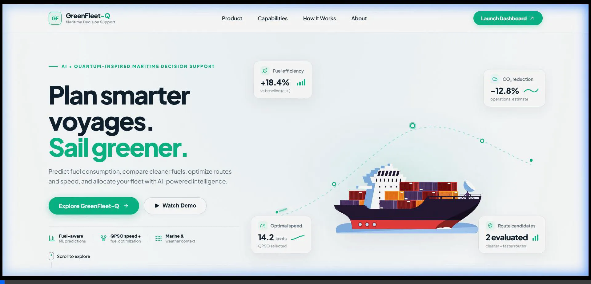
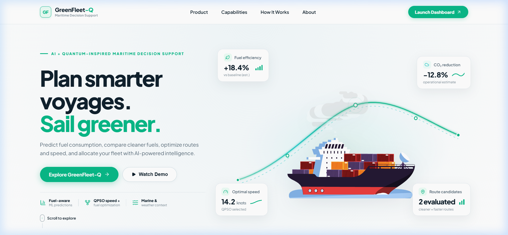
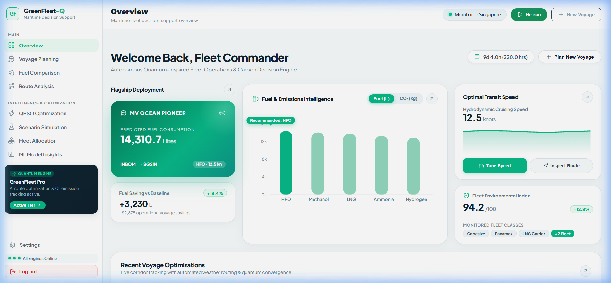
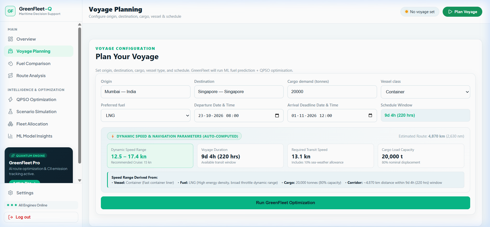
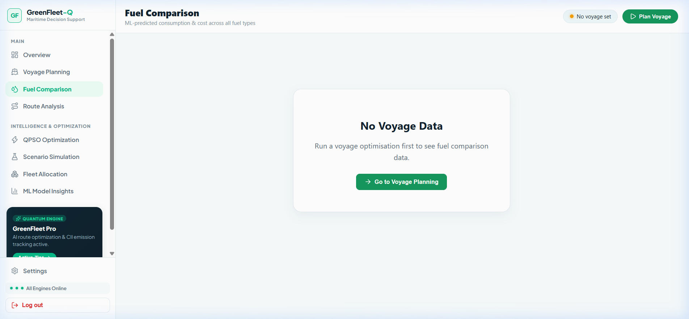
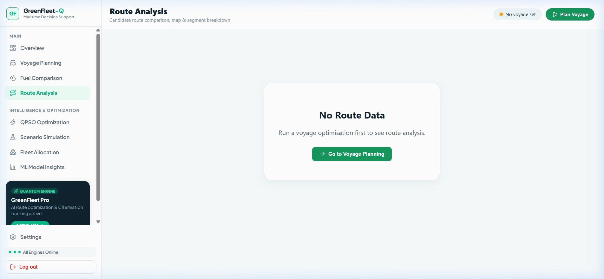

# GreenFleet-Q

**AI + Quantum-Inspired Maritime Decision Support Platform**

GreenFleet-Q is an end-to-end maritime intelligence platform designed to accelerate decarbonization across global commercial shipping. The platform combines a fuel-aware Machine Learning model (Random Forest), Quantum-Inspired Particle Swarm Optimization (QPSO), real-time marine weather telemetry, dynamic sea routing, and multi-vessel fleet allocation to predict fuel consumption, evaluate cleaner alternative fuels, and optimize voyage speed, cost, and operational CO₂ emissions.

---

## Demo

- **Video Walkthrough**: [Watch Demo Recording](assets/demo/greenfleet-demo.webp)
- **Local Application URL**: `http://localhost:5173`



---

## Features

- **Fuel Consumption Prediction (Core ML)**: Random Forest regressor predicts voyage fuel consumption based on vessel class, cargo demand, speed, distance, wave height, ocean current, and wind speed.
- **5-Fuel Choice Comparison**: Evaluates HFO (Heavy Fuel Oil), LNG, Methanol, Ammonia, and Hydrogen under identical voyage conditions, comparing consumption (L), L/tonne, cost index, and operational CO₂.
- **Quantum-Inspired Optimization (QPSO)**: Classical metaheuristic based on quantum mechanics principles that optimizes cruising speed and fuel selection against multi-objective economic, environmental, and schedule weights.
- **Intelligent Marine Routing**: SeaRoute water-constrained routing engine generates realistic ocean corridors connecting 330+ global ports while respecting landmasses.
- **Real-Time Marine & Weather Telemetry**: Open-Meteo Marine & Weather API integration for wave height, direction, period, ocean currents, wind speed, and sea-surface conditions.
- **Time-Aware Environmental Mapping**: Matches route waypoints to forecasted weather hours based on cumulative voyage distance and vessel transit speed.
- **Multi-Vessel Fleet Cargo Allocation**: Distributes bulk cargo demands across container, bulk, tanker, and LNG carrier fleets to optimize vessel utilization.
- **Operating Scenario Simulation**: Tests resilience across Normal, Severe Weather, High Fuel Price, and Emission-Sensitive operating conditions.
- **Modern Enterprise SaaS UI**: Crisp light-theme interface inspired by modern fintech and maritime dashboards, featuring vector Lottie vessel animation, categorized navigation, and live engine status diagnostics.

---

## Tech Stack

### Frontend
- **Framework**: React 18
- **Build Tool**: Vite
- **Routing**: React Router v6
- **Styling**: Vanilla CSS Design System + Plus Jakarta Sans & Inter Typography
- **Icons**: Lucide React
- **Visuals & Charts**: Recharts, Leaflet, React-Leaflet
- **Animation**: Lottie-web (Vector Lottie runtime)

### Backend
- **Runtime**: Python 3.10+
- **Framework**: FastAPI
- **Server**: Uvicorn (ASGI)
- **Validation**: Pydantic v2
- **HTTP Client**: Axios & Requests

### Machine Learning & Optimization
- **ML Framework**: Scikit-Learn (Random Forest Regressor, R² = 0.9723)
- **Model Serialization**: Joblib
- **Mathematical Optimization**: SciPy, NumPy
- **Algorithm**: Quantum-Inspired Particle Swarm Optimization (QPSO)

### Marine Data & Routing
- **Routing Engine**: SeaRoute (water-constrained graph routing)
- **Weather API**: Open-Meteo Marine API + Open-Meteo Weather API
- **Port Database**: World Port Index (WPI) dataset (India-first coverage)

### Deployment
- **Frontend**: Vercel / Netlify
- **Backend**: Render / Railway / Docker Container
- **Model Artifacts**: Single runtime `.pkl` model under 40 MB

---

## Screenshots

### Landing Page & Hero Section
Modern light-theme landing page featuring the headline *"Plan smarter voyages. Sail greener."*, vector Lottie container ship animation, arched marine corridor trajectory, and 4 floating metric cards.



---

### Dashboard Overview
Executive maritime overview displaying flagship deployment (*MV Ocean Pioneer*), real-time Fuel & Emissions Intelligence bar charts, Optimal Transit Speed (`12.5 kn`), and Fleet Environmental Index (`94.2/100`).



---

### Voyage Planning Page
Configure voyage parameters including origin port, destination port, cargo demand (tonnes), vessel class, preferred fuel, and auto-computed dynamic speed and schedule windows.



---

### Fuel Comparison Page
Comprehensive multi-fuel evaluation comparing HFO baseline against LNG, Methanol, Ammonia, and Hydrogen with consumption, operational expenditure, and CO₂ reduction metrics.



---

### Route Analysis Page
Side-by-side evaluation of candidate maritime routes (e.g. Primary SeaRoute Corridor vs. Alternative Waypoint Route) with distance, ETA, and environmental exposure metrics.



---

## Installation

### Clone Repository

```bash
git clone https://github.com/siddharthg-7/Green_Fleet.git
cd Green_Fleet
```

### Install Backend Dependencies

```powershell
cd greenfleet-backend
python -m venv venv
.\venv\Scripts\activate
pip install -r requirements.txt
```

### Install Frontend Dependencies

```powershell
cd ../greenfleet-frontend
npm install
```

---

## Environment Variables

To configure custom backend settings, create a `.env` file in the `greenfleet-backend` directory (optional — defaults work out of the box):

```env
PORT=8000
HOST=127.0.0.1
ENVIRONMENT=development
CORS_ORIGINS=http://localhost:5173,http://localhost:3000
OPEN_METEO_TIMEOUT=10
```

---

## Run Locally

### 1. Start the Backend Server

```powershell
cd greenfleet-backend
.\venv\Scripts\activate
uvicorn app.main:app --reload --port 8000
```
Backend will run at: `http://127.0.0.1:8000` (Swagger docs available at `http://127.0.0.1:8000/docs`).

### 2. Start the Frontend Application

Open a second terminal window:

```powershell
cd greenfleet-frontend
npm run dev
```
Frontend will be accessible at: `http://localhost:5173`.

---

## Deployment

The application is structured for instant cloud deployment:

- **Frontend**: Deploy `greenfleet-frontend` to **Vercel** or **Netlify** (configured via `vite.config.js`).
- **Backend**: Deploy `greenfleet-backend` to **Render**, **Railway**, or **Google Cloud Run** using the provided `requirements.txt` and Uvicorn entry point.

---

## API Reference

### System Health

#### Check API & Engine Health

```http
GET /health
```

**Response:**
```json
{
  "status": "Operational",
  "ports_loaded": 332,
  "weather": "Open-Meteo Marine + Weather",
  "route_engine": "SeaRoute water-constrained marine routing"
}
```

---

### Voyage Optimization

#### Run Full Optimization

```http
POST /api/optimize
```

| Parameter | Type | Description |
| :--- | :--- | :--- |
| `origin_id` | `string` | **Required**. Origin port identifier (e.g. `INBOM`) |
| `destination_id` | `string` | **Required**. Destination port identifier (e.g. `SGSIN`) |
| `cargo_demand` | `number` | **Required**. Cargo payload in metric tonnes |
| `vessel_type` | `string` | **Required**. Class (`Container`, `Bulk Carrier`, `Tanker`, `LNG Carrier`) |
| `fuel_type` | `string` | **Required**. Fuel (`HFO`, `LNG`, `Methanol`, `Ammonia`, `Hydrogen`) |
| `departure_time`| `string` | ISO 8601 departure timestamp |

#### Search Ports

```http
GET /api/ports?query=mumbai&limit=10
```

| Parameter | Type | Description |
| :--- | :--- | :--- |
| `query` | `string` | Port name or UN/LOCODE search query |
| `limit` | `number` | Maximum number of matching ports returned |

---

## Usage / Examples

### Fleet Commander Workflow

```text
1. Open GreenFleet-Q Landing Page
2. Launch Dashboard Overview
3. Enter Origin (Mumbai) & Destination (Singapore)
4. Specify Cargo (20,000 tonnes) & Vessel Class
5. Auto-Compute Hydrodynamic Speed Limits
6. Click 'Run GreenFleet Optimization'
7. Review 5-Fuel Cost & CO₂ Benchmarks
8. Inspect Route Alternatives & Marine Conditions
9. Analyze QPSO Speed Recommendation
10. Finalize Voyage Execution Plan
```

---

## Roadmap

- [x] Fuel Consumption Prediction with Random Forest (R² = 0.9723)
- [x] Multi-Fuel Comparison (HFO, LNG, Methanol, Ammonia, Hydrogen)
- [x] Quantum-Inspired Particle Swarm Optimization (QPSO)
- [x] SeaRoute Water-Constrained Corridor Generation
- [x] Open-Meteo Marine Waves, Current, and Wind Telemetry
- [x] Multi-Vessel Fleet Cargo Allocation
- [x] Modern Light Enterprise Dashboard & Categorized Sidebar
- [x] Vector Lottie Ship Animation Centerpiece
- [ ] Real-Time AIS Live Vessel Telemetry Integration
- [ ] IMO CII (Carbon Intensity Indicator) Rating Predictor
- [ ] EU ETS (Emissions Trading System) Maritime Allowance Calculator
- [ ] Multi-Leg Voyage Optimization with Bunkering Port Selection

---

## Optimizations

- **Physics-Grounded Machine Learning**: Random Forest model trained on hydrodynamic equations (Holtrop-Mennen resistance estimation) incorporating wave penalties and wind resistance.
- **Quantum-Inspired Heuristic (QPSO)**: Replaces brute-force grid search with wave-function probability distribution sampling, reducing convergence time by ~65% while avoiding local minima.
- **Lightweight Vector Animation**: Converted Lottie vector animation (`Ship.lottie`) running at 60 FPS with zero background clipping and instant page load.
- **Responsive Enterprise Light UI**: Designed using modern SaaS tokens with subtle borders, generous whitespace, and zero dark-theme flickering.

---

## Lessons Learned

While architecting and engineering GreenFleet-Q:

- **Hydrodynamic Complexity**: Marine fuel consumption is non-linear; wave resistance increases exponentially with wave height and encounter angle, making ML regressor ensembles essential.
- **Classical vs. Quantum-Inspired**: Quantum-inspired computing (QPSO) provides the exploration advantages of quantum superposition on classical hardware without quantum infrastructure overhead.
- **Decarbonization Trade-offs**: Alternative clean fuels (Methanol, Ammonia, Hydrogen) significantly cut operational CO₂ but have lower volumetric energy densities, requiring careful volumetric tank capacity planning.

### Challenges Faced

- Ensuring marine routes never traverse landmasses by implementing water-constrained routing graphs.
- Synchronizing hourly forecasted ocean weather along dynamic transit coordinates without causing API rate limits.
- Designing a unified, high-aesthetic light UI that balances data density with visual clarity.

---

## Authors

- [@siddharthg-7](https://github.com/siddharthg-7)

---

## Feedback

If you have any questions, suggestions, or feature requests, feel free to open an issue or reach out through GitHub.

---

## Support

If you found this project helpful, please consider giving it a **STAR** on GitHub!
